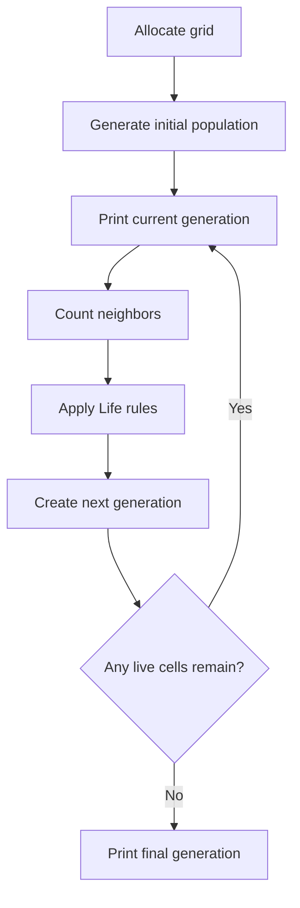

<div align="center">

# Conway's Game of Life

**A terminal-based C++ simulation of a cellular automaton.**


</div>

## Contents

- [Overview](#overview)
- [Rules](#rules)
- [Simulation model](#simulation-model)
- [Requirements](#requirements)
- [Build and run](#build-and-run)
- [Configuration](#configuration)
- [Known implementation details](#known-implementation-details)
- [License](#license)

## Overview

This project implements Conway's Game of Life in C++. A two-dimensional grid evolves in discrete generations: each cell's next state depends on the number of live cells in its neighborhood.

The simulation renders the grid in a terminal and generates an initial population randomly.

## Rules

For each generation:

1. A live cell with fewer than two live neighbors dies.
2. A live cell with two or three live neighbors survives.
3. A live cell with more than three live neighbors dies.
4. A dead cell with exactly three live neighbors becomes alive.

## Simulation model



The neighbor calculation wraps coordinates at the grid edges, producing a toroidal world rather than a grid with dead borders.

## Requirements

- C++ compiler
- Linux/POSIX environment (the source uses `unistd.h`, `usleep()`, and `clear`)

## Build and run

```bash
git clone https://github.com/Edumarek123/jogoDaVida.git
cd jogoDaVida
g++ -std=c++11 -O2 -Wall -Wextra main.cpp -o game_of_life
./game_of_life
```

The source includes a delay of approximately 100 ms between generations.

## Configuration

The grid dimensions are currently defined in `main.cpp`:

| Variable | Current value | Meaning |
|---|---:|---|
| `Tamanho_X` | 105 | Number of rows |
| `Tamanho_Y` | 585 | Number of columns |

Change these values before compiling to experiment with different grid sizes. Large dimensions require a terminal capable of displaying the output.

## Known implementation details

The current implementation uses dynamically allocated matrices and a random initialization routine. The initialization and memory-management code would benefit from further review before the simulation is used as a robust or long-running program.

## License

No `LICENSE` file is currently included. Unless a license is added, reuse and redistribution permissions are not granted by this repository.
